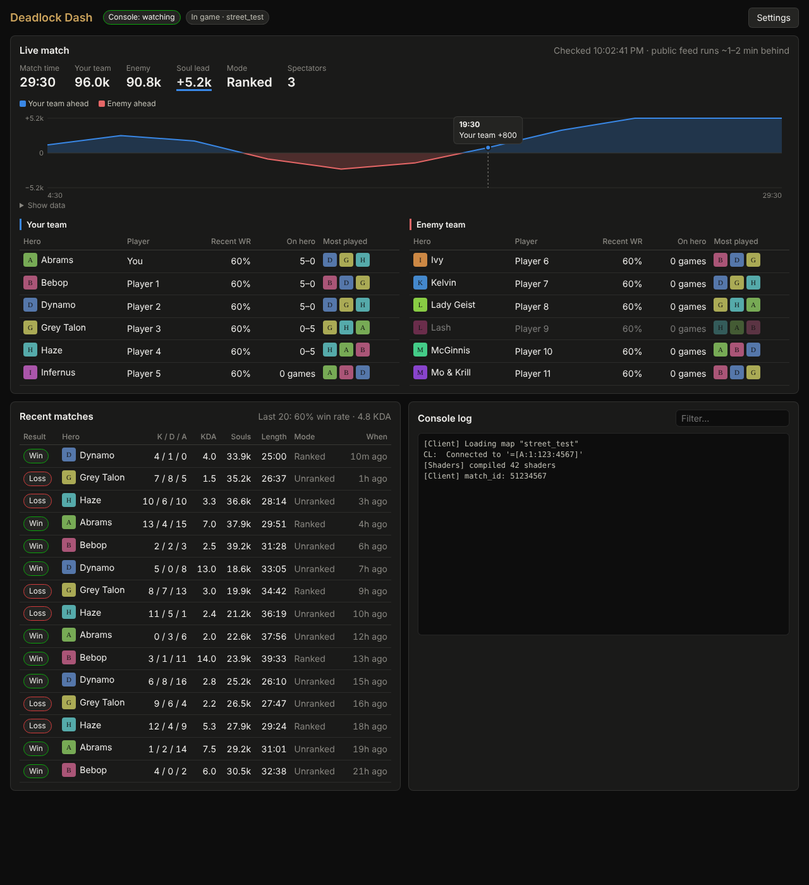

# Deadlock Dash

A second-monitor companion app for [Deadlock](https://store.steampowered.com/app/1422450/Deadlock/), built with [Tauri 2](https://v2.tauri.app/) (Rust) and React + TypeScript.


<sub>Screenshot rendered with mock data.</sub>

> **Status: early scaffold.** It runs and shows real data from the public API. Parts of it are still guesses that need checking against the real game (see [Known gaps](#known-gaps)).

## What it does

| Panel | Source | Notes |
|---|---|---|
| **Live match** | The match's spectator broadcast, parsed by deadlock-api.com ([`/v1/matches/demo/live/query`](https://api.deadlock-api.com/docs), SSE) | Starts automatically when the console log shows you in a match. Every player's name, hero, level, souls, K/D/A, hero damage, items and alive/dead state, plus team souls and a soul-lead graph, the match clock, Street Brawl round and score, a kill feed, and the result. It stays up after the match. Runs behind the real game by Valve's spectator delay. |
| **Timers** | `console.log` for the clock, the broadcast for respawns | Countdown and voice warnings for camps, boxes and statues, bridge buffs, the Mid Boss, the Unstable Rift and (optionally) trooper waves. The clock comes from the moment the log shows the game going live, so it isn't delayed. Mid Boss and camp respawns come from the game's own timers in the broadcast: they arrive late but are absolute times, so they still show if they haven't passed yet. See `src/lib/timers.ts` for which times were checked against game data. |
| **Live match (fallback)** | [`/v1/matches/active`](https://api.deadlock-api.com/docs) | Shown when there is no broadcast feed. Covers only the ~200 matches in the in-game Watch tab, but adds scouting (recent win rate, record on their hero, most-played heroes). |
| **Recent matches** | Local database, topped up from `/v1/players/{account_id}/match-history` | Your last 15 games, plus overall win rate and KDA. Matches the API doesn't have yet still show up from the live feed or your console log. |
| **Profile** | Local database | Totals, per-hero record and full match list for you, plus everyone you've shared a match with (win–loss with and against them). Click a player to open their profile. |
| **Match report** | `game/citadel/console.log` | Your hero, deaths with respawn time and the hero on your killcam, hit-registration mismatches, ping/jitter/server relay, FPS, queue and load times, plus plain-language takeaways. Works for every match, live and after it ends. |
| **Console log** | `game/citadel/console.log` (needs the `-condebug` launch option) | Detects when you're in a game and shows the raw log with a filter. |

It also finds your Steam install, your Deadlock folder, and the Steam account you're logged into by reading Steam's config files (`libraryfolders.vdf`, `loginusers.vdf`).

### Fair-play rules this project follows

- **Never** reads or writes game memory, and never injects into the game process.
- **Never** captures or decrypts the game's network traffic.
- Uses only public data (the delayed spectator broadcast and match history) and files the game writes on purpose (`console.log`).
- The live scoreboard shows only what the in-game scoreboard already shows (souls, K/D/A, items). It never queries hero positions, cooldowns or other hidden state.
- Timers use only the public spawn schedule and the camp and Mid Boss timers the in-game minimap already shows.

Valve delays the spectator feed to stop it being used for live advantage, so the app respects that delay.

## Getting started

### Prerequisites

- [Node.js](https://nodejs.org/) 20+
- [Rust](https://rustup.rs/) (stable)
- The Tauri platform prerequisites: https://v2.tauri.app/start/prerequisites/. On Windows that means the Microsoft C++ Build Tools and WebView2 (WebView2 is already installed on Windows 10 and 11).

### Run

```sh
npm install
npm run tauri dev      # dev build with hot reload
npm run tauri build    # installer in src-tauri/target/release/bundle/
```

`tauri build` signs the installer for the updater, so it needs `TAURI_SIGNING_PRIVATE_KEY` (the key itself or a path to it) and `TAURI_SIGNING_PRIVATE_KEY_PASSWORD` set. `tauri dev` doesn't.

### Releases and auto-update

Every merge to `main` runs [`.github/workflows/release.yml`](.github/workflows/release.yml). It tags the merged commit with the next patch version (newest `v*` tag + 1, e.g. `v0.1.1` → `v0.1.2`), builds the NSIS installer (`Deadlock Dash_<version>_x64-setup.exe`) and publishes it on the Releases page together with a signed `latest.json`.

For a minor or major bump, push the tag yourself; later merges count up from it:

```sh
git tag v0.2.0
git push origin v0.2.0
```

The tag sets the version, so there's nothing to bump by hand. On startup, release builds check `latest.json` from the newest release and, if it's newer, download it, install it and restart (`src-tauri/src/updater.rs`). The workflow needs the repository secrets `TAURI_SIGNING_PRIVATE_KEY` and `TAURI_SIGNING_PRIVATE_KEY_PASSWORD`; the matching public key is in `tauri.conf.json`. Losing the private key means installed copies can't update anymore.

### Turn on the console log

In Steam, right-click **Deadlock → Properties → General → Launch Options** and add:

```
-condebug
```

The game then writes its console output to `…\steamapps\common\Deadlock\game\citadel\console.log`, and the app tails that file.

### Optional: API key

deadlock-api.com works without a key. If you have one, set the `DEADLOCK_API_KEY` environment variable before starting the app. It's sent as `X-API-KEY` from the Rust side only; frontend code never sees it.

## Project layout

```
src-tauri/src/
  lib.rs           Tauri commands: detect_environment, start/stop_console_watch, api_get
  steam.rs         Finds Steam, Deadlock and the logged-in account (with unit tests)
  console_log.rs   Tails console.log, emits lines and parsed game events (with unit tests)
  match_report.rs  Infers a per-match report from console.log (with unit tests)
  api.rs           Proxy to api.deadlock-api.com (no CORS issues, API key stays in Rust)
  live.rs          Live scoreboard from the spectator broadcast over SSE (with unit tests)
  db.rs            Local SQLite store for matches, players and reports (with unit tests)
  updater.rs       Installs the newest GitHub release on startup
src/
  api/             Typed API client, response types, Tauri bridge types
  hooks/           Settings, hero list, console-watch state machine
  lib/             Formatting, stats aggregation, SteamID parsing
  components/      LiveMatch, NetWorthChart, RecentMatches, ProfilePage, TimersPanel, ConsoleTail, SettingsDialog
```

Checks:

```sh
npm run typecheck
cd src-tauri && cargo test && cargo clippy --all-targets
```

## Local database

Matches are saved to SQLite at `%APPDATA%\com.deadlockdash.app\deadlock-dash.db` (Tauri's app data folder on other platforms). Three sources feed it:

1. **Console report**: your matches only, no result or scoreboard. It's the one source that doesn't depend on a third party.
2. **Live broadcast**: all 12 players' names, heroes, stats and items, plus every kill (who killed whom, assists, souls, match time). Saved every 30 s and when the feed ends.
3. **API match history**: one player per match, with the authoritative result. Saved whenever the app fetches it, including when it scouts other players.

Each row remembers the best source that wrote it. A better source overwrites a worse one, and a worse one only fills in blanks, so the order things arrive in doesn't matter. `src-tauri/src/db.rs` has the schema and these rules.

Every row has `updated_at` and `synced_at`, ready for a future cloud sync to pick up whatever changed. The **Contribute my matches** setting (on by default) is the user's opt-out from that sync. Nothing is uploaded yet.

## Known gaps

1. **Live feed rate limits.** Turning a match ID into a broadcast URL spectates the lobby, which is limited to 6 per hour per IP without an API key. The app checks the free `/v1/matches/live/urls` list first and caches each URL, so it uses at most one lookup per match. The broadcast relay needs a minute or two after a match starts before it has data. To test the feed against any live match, run `DEADLOCK_BROADCAST_URL=<url> cargo test live_broadcast -- --ignored --nocapture`.
2. **The match report is inferred.** The log has no scoreboard, so kills, souls, items and the result aren't in it. `src-tauri/src/match_report.rs` was checked against a real Street Brawl log (build 10932); its doc comment explains how each field is derived. Deaths come from the client pausing prediction while you're dead, and the roster is approximate. To check a new log, run `DEADLOCK_CONSOLE_LOG=<path> cargo test real_log -- --ignored --nocapture`. The older `parse_line` patterns in `console_log.rs` are still mostly guesses.
3. **Match history can be incomplete.** deadlock-api gets full history only for accounts that are friends with one of its bots. For other accounts it returns what it has stored. See their [ingest page](https://deadlock-api.com/ingest-cache).

## Roadmap

- **Scouting in the live scoreboard.** Merge the fallback panel's per-player history (recent win rate, record on their hero) into the broadcast scoreboard.
- **Post-match breakdown** from the replay file (`/v1/matches/{match_id}/metadata`, or demo parsing).
- Compact or always-on-top mode, a tray icon, and remembering window position per monitor.
- If Valve ever adds official Game State Integration (as in CS2 and Dota 2), switch the live panel to it.

## Credits

Data comes from the community [deadlock-api.com](https://deadlock-api.com) project. Deadlock Dash is not affiliated with or endorsed by Valve.
